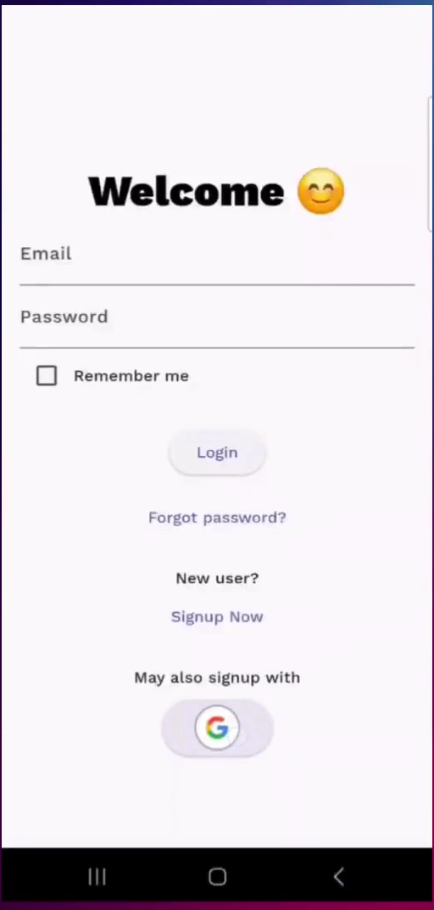
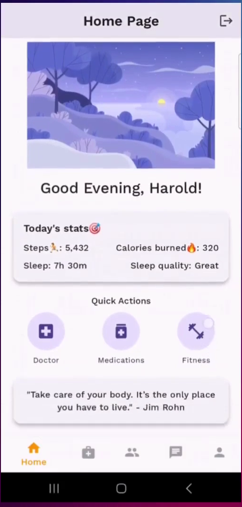
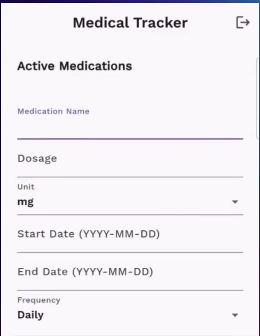
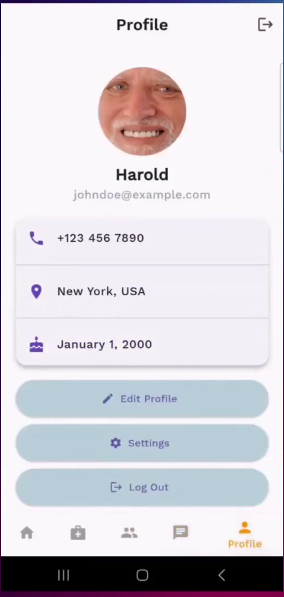
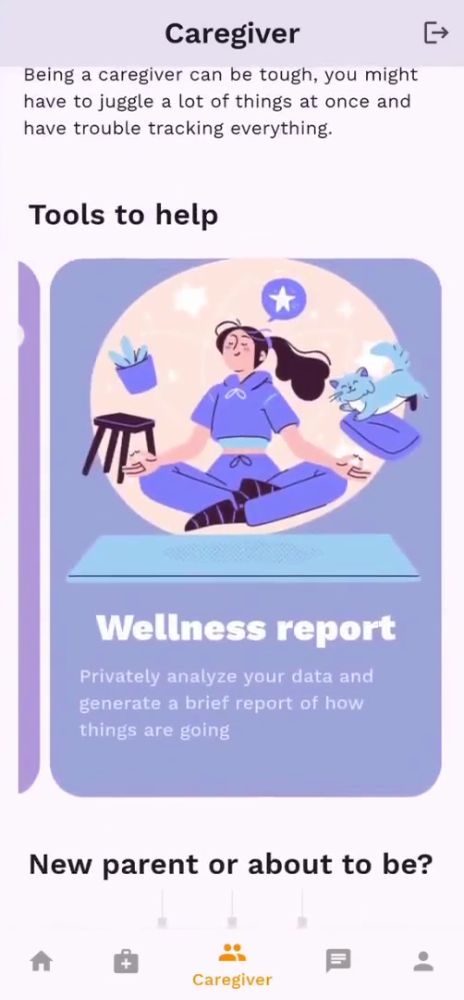
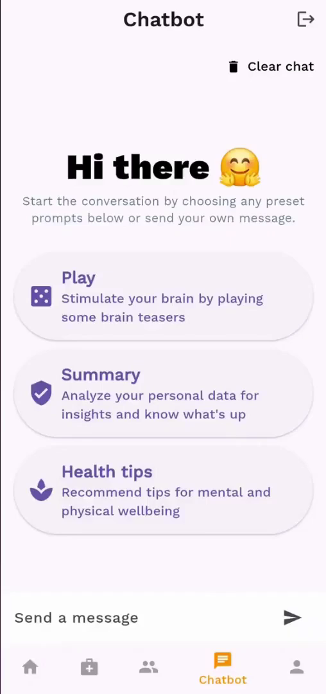
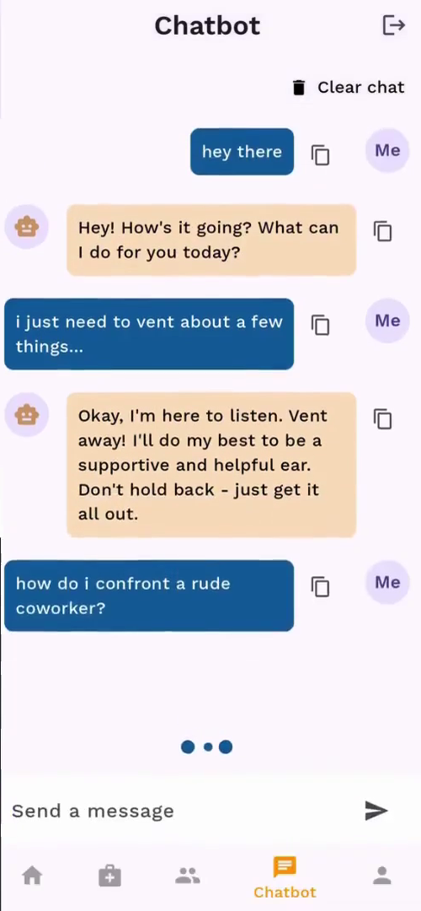

# Aura Health: An AI-powered healthcare, lifestyle & wellness superapp

> **Hackathon:** AITEX Summit, Fall 2026 (From Prompt to Product)
> **Track:** AI for Society
> **Team:** Aura Health
> **Dates:** November 21 to 23, 2026

Aura Health brings care, medication management, and personalized wellness guidance
into a single mobile companion. An AI assistant answers everyday health questions,
generates tailored wellness reports, and helps patients and their caregivers stay on
top of medication schedules, all in the user's own language.

---

## Pitch video

**[Watch the pitch video (`AuraHealth_Pitch_FINAL.mp4`)](AuraHealth_Pitch_FINAL.mp4)**

A roughly 4-minute walkthrough of the problem, the solution, a full front-end demo, and
the Firebase and Gemini backend. The file lives in the repository root, so you can click
to download and play, or open it locally.

---

## Screenshots

| Login | Home | Medication tracker |
| :---: | :---: | :---: |
|  |  |  |
| **Profile** | **Caregiver** | **AI chatbot** |
|  |  |  |

**AI chatbot in conversation**



---

## Why "AI for Society"

> *"Develop technology for healthcare, education, accessibility and sustainability,
> solutions that make a meaningful difference."*

Aura Health is built squarely for this track:

- **Healthcare impact:** medication adherence tracking with smart reminders directly
  addresses one of the most common and costly problems in chronic-care management.
- **Accessibility:** a full four-language interface (English, 中文, ภาษาไทย, and
  Burmese) makes the app usable across underserved, multilingual communities.
- **Caregiver inclusion:** dedicated caregiver tools recognize that health outcomes
  depend on families and support networks, not just individual patients.
- **Meaningful AI:** the AI assistant and wellness reports turn raw health data and
  user questions into clear, actionable guidance rather than another chat gimmick.

---

## Features

| Feature | What it does |
| --- | --- |
| **AI health assistant** | Conversational assistant (Google Gemini) that answers health and lifestyle questions, with locally cached chat history. |
| **Medication tracker** | Schedule medications and receive local push reminders so doses aren't missed. |
| **AI wellness reports** | Generates a personalized, easy-to-read wellness summary from the user's health stats. |
| **Caregiver mode** | Caregiver dashboard to follow a patient's adherence and wellness, and to order supplies on their behalf. |
| **Patient & doctor tracking** | Role-aware experience linking patients to clinics and doctors. |
| **Supplies shop** | In-app storefront for health and wellness supplies. |
| **Multilingual** | Full localization in English, Chinese, Thai, and Burmese. |
| **Notifications** | Firebase Cloud Messaging and local notifications for reminders and updates. |

---

## Tech stack

- **Flutter** (Dart `^3.7.2`): cross-platform for Android, iOS, web, macOS, Linux, Windows
- **Firebase**: Authentication (including Google Sign-In), Cloud Firestore, Cloud Messaging
- **Google Gemini API** (`gemini-2.0-flash`): AI assistant and wellness report generation
- **flutter_local_notifications**: medication reminders
- **flutter_localizations / intl**: four-language support

---

## Getting started

```bash
cd app
flutter pub get
```

Create a `.env` file in `app/` with the required API key(s):

```env
GEMINI_API_KEY=your_api_key_here
```

Add your Firebase configuration for the platforms you intend to run
(`google-services.json` for Android, `GoogleService-Info.plist` for iOS), then:

```bash
flutter run
```

See [`app/README.md`](app/README.md) for more development details.

---

## Credits

Designed and built by Team Aura Health for the AI for Society track at AITEX Summit (Fall 2026).
